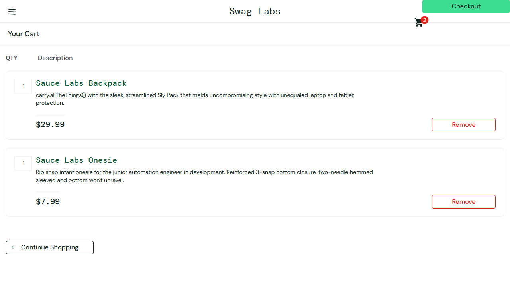

# BUG-001: Cart is not cleared on logout and is shown to the next user

| | |
| --- | --- |
| **System** | SauceDemo |
| **Environment** | https://www.saucedemo.com/, Chromium 1255 (Playwright), Firefox, WebKit; Windows 11; 1280×720 |
| **Test user / data** | `standard_user` then `visual_user` (reproduces with any pair of users) |
| **Severity** | Major (one customer's cart is shown to another; on a shared device this leaks what someone was buying) |
| **Priority** | P1 |
| **Found by** | Exploratory session 2026-11-16, confirmed by TC-SD-037 |
| **Reproducibility** | Always (3 browsers) |
| **Status** | Open |

## Preconditions

A fresh browser profile. No items in the cart.

## Steps to reproduce

1. Log in as `standard_user` / `secret_sauce`.
2. Add **Sauce Labs Backpack** and **Sauce Labs Onesie** to the cart. The badge shows 2.
3. Open the menu → **Logout**.
4. Log in as `visual_user` / `secret_sauce`.
5. Look at the cart badge and open the cart.

## Expected result

`visual_user` starts with an empty cart. Logging out ends the previous shopper's session, including the cart.

## Actual result

The badge shows **2**, and the cart contains the Backpack and the Onesie added by `standard_user`.

## Evidence

Automated reproduction: `tests/saucedemo/auth.spec.ts` → TC-SD-037 (marked `test.fail`, so the suite stays green until this is fixed), and `features/saucedemo/login.feature` (scenario tagged `@fail`).

## Notes

- Not one of the site's intentionally broken test users: it happens with the reference user `standard_user`.
- The cart is stored in browser storage and survives reloads by design (TC-SD-020). Logout should clear it, or the cart should be keyed by user.
- **Reset App State** does clear the cart (TC-SD-021), which is a workaround for testers but not for customers.
