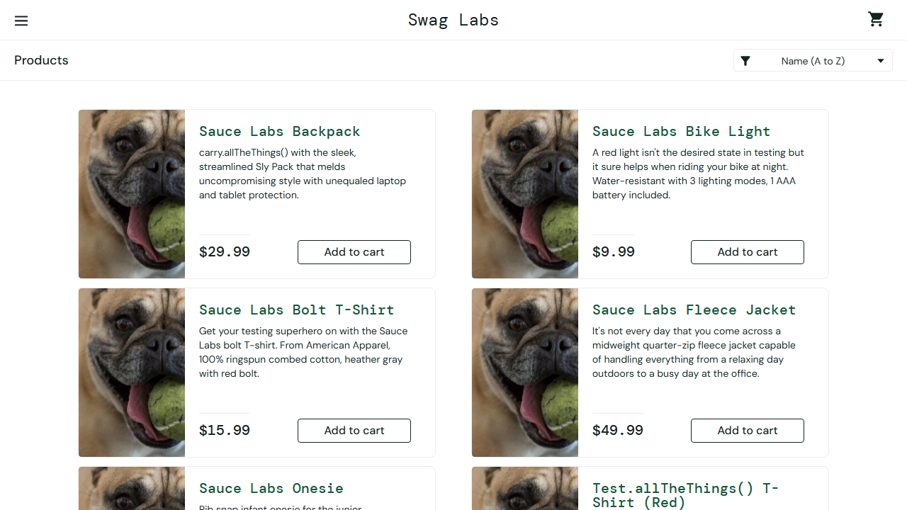

# BUG-002: Product images replaced by a "not found" placeholder

| | |
| --- | --- |
| **System** | SauceDemo |
| **Environment** | https://www.saucedemo.com/inventory.html, Chromium, Firefox, WebKit; Windows 11; 1280×720 |
| **Test user / data** | `problem_user` (all 6 products), `visual_user` (Backpack only) |
| **Severity** | Minor (shopping still works, but the customer cannot see what they buy) |
| **Priority** | P3 |
| **Found by** | Exploratory session 2026-11-16, confirmed by TC-SD-011 |
| **Reproducibility** | Always |
| **Status** | Open |

## Steps to reproduce

1. Log in as `problem_user` / `secret_sauce`.
2. Look at the product images on **Products**.

## Expected result

Each of the 6 products shows its own photo, as for `standard_user`.

## Actual result

All 6 cards show the same image, `/assets/sl-404-….jpg` (a dog with a "404" sign). For `visual_user`, only the Backpack shows it.

## Evidence

Automated: `tests/saucedemo/catalog.spec.ts` → TC-SD-011 (`problem_user`, `visual_user`), expected failure.

## Notes

The image files load successfully (HTTP 200), so this is a wrong `src`, not a broken asset.
