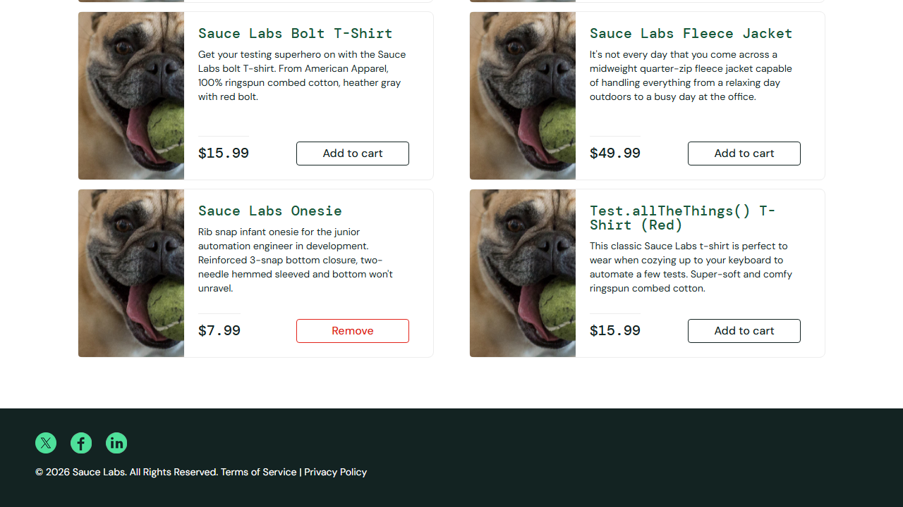

# BUG-003: "Add to cart" does nothing for three products

| | |
| --- | --- |
| **System** | SauceDemo |
| **Environment** | https://www.saucedemo.com/inventory.html, Chromium, Firefox, WebKit; Windows 11 |
| **Test user / data** | `problem_user`, `error_user` |
| **Severity** | Major (half the catalog cannot be bought) |
| **Priority** | P1 |
| **Found by** | Exploratory session 2026-11-16, confirmed by TC-SD-016 |
| **Reproducibility** | Always, same three products for both users |
| **Status** | Open |

## Steps to reproduce

1. Log in as `problem_user` / `secret_sauce`.
2. Click **Add to cart** on each of the 6 products, watching the cart badge.

## Expected result

The badge goes 1, 2, 3, 4, 5, 6 and every button changes to **Remove**.

## Actual result

The badge stops at **3**. The buttons of **Sauce Labs Bolt T-Shirt**, **Sauce Labs Fleece Jacket** and **Test.allTheThings() T-Shirt (Red)** stay as **Add to cart** and the items are never added. Same result for `error_user`.

## Evidence

Automated: `tests/saucedemo/cart.spec.ts` → TC-SD-016, soft assertion per product, so the report names each failing button.

## Notes

The same three products fail for both users, which suggests one shared cause (for example the handler of every second product), not a random one.
