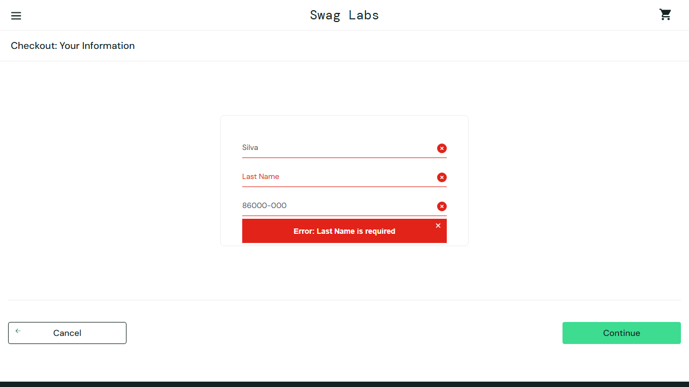

# BUG-004: Typing in Last Name overwrites First Name, so checkout is blocked

| | |
| --- | --- |
| **System** | SauceDemo |
| **Environment** | https://www.saucedemo.com/checkout-step-one.html, Chromium, Firefox, WebKit; Windows 11 |
| **Test user / data** | `problem_user` |
| **Severity** | Critical (the user cannot complete any purchase) |
| **Priority** | P1 |
| **Found by** | Exploratory session 2026-11-16, confirmed by TC-SD-022 and TC-SD-024 |
| **Reproducibility** | Always |
| **Status** | Open |

## Steps to reproduce

1. Log in as `problem_user` / `secret_sauce`.
2. Add any product, open the cart, click **Checkout**.
3. Type `Ana` in **First Name**.
4. Type `Silva` in **Last Name**.
5. Type `86000-000` in **Postal Code** and click **Continue**.

## Expected result

First Name = `Ana`, Last Name = `Silva`; the overview page opens.

## Actual result

After step 4, **First Name shows `Silva`** and **Last Name is empty**. Continue shows `Error: Last Name is required`. There is no way to fill Last Name, so the purchase cannot continue.

## Evidence

Automated: `tests/saucedemo/checkout.spec.ts` → TC-SD-022 and TC-SD-024 for `problem_user`, expected failures.

## Notes

Looks like the Last Name input is bound to the First Name field's state.
