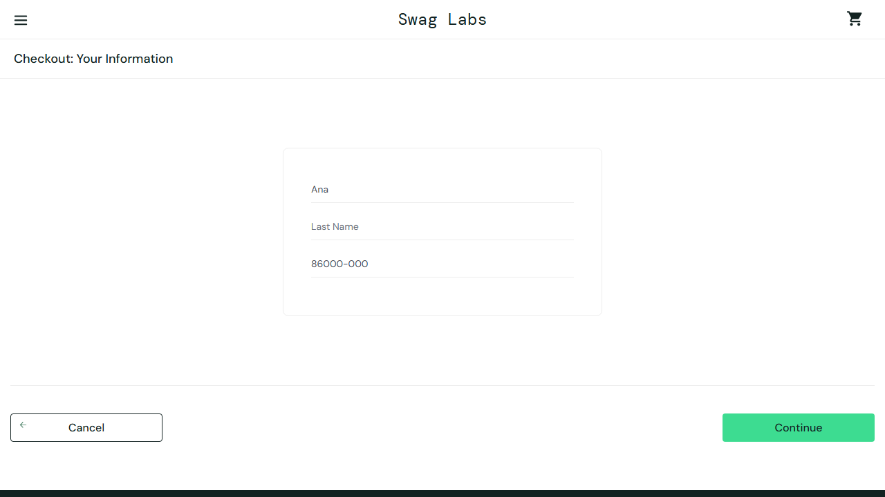

# BUG-005: Last Name field ignores input, but checkout continues without it

| | |
| --- | --- |
| **System** | SauceDemo |
| **Environment** | https://www.saucedemo.com/checkout-step-one.html, Chromium, Firefox, WebKit; Windows 11 |
| **Test user / data** | `error_user` |
| **Severity** | Major (orders are placed without the customer's last name; the required-field rule is bypassed) |
| **Priority** | P2 |
| **Found by** | Exploratory session 2026-11-16, confirmed by TC-SD-024 |
| **Reproducibility** | Always |
| **Status** | Open |

## Steps to reproduce

1. Log in as `error_user` / `secret_sauce`.
2. Add any product, open the cart, click **Checkout**.
3. Type `Ana` in **First Name**, `Silva` in **Last Name**, `86000-000` in **Postal Code**.
4. Click **Continue**.

## Expected result

Last Name shows `Silva`. If it were empty, Continue would show `Error: Last Name is required` (as it does for `standard_user`, TC-SD-023).

## Actual result

**Last Name stays empty** while typing, yet **Continue moves on to the overview**. Two defects together: the field drops input, and the validation that should catch the empty field does not run.

## Evidence

Automated: `tests/saucedemo/checkout.spec.ts` → TC-SD-024 for `error_user`, expected failure.
