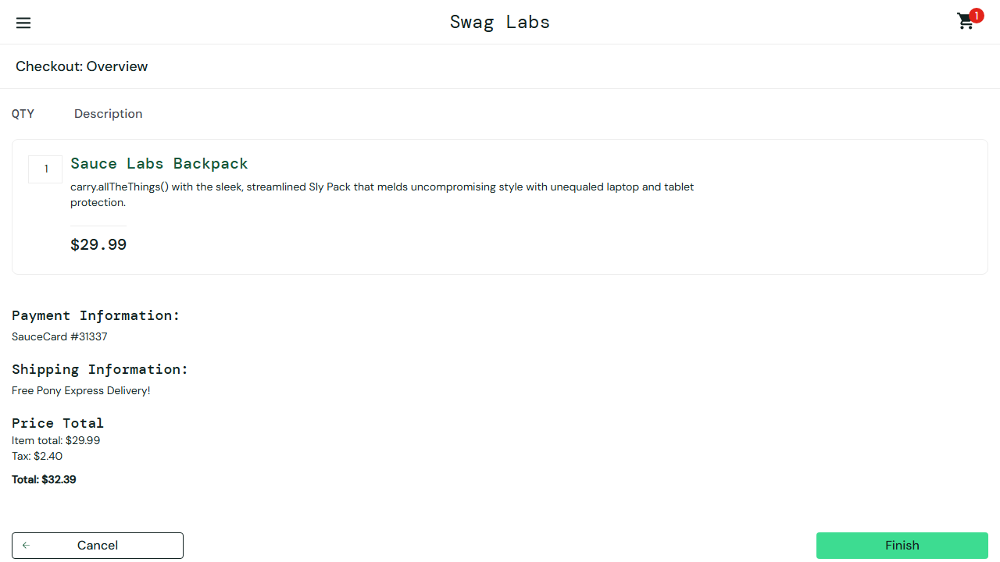

# BUG-006: Finish does nothing, so the order never completes

| | |
| --- | --- |
| **System** | SauceDemo |
| **Environment** | https://www.saucedemo.com/checkout-step-two.html, Chromium, Firefox, WebKit; Windows 11 |
| **Test user / data** | `error_user` |
| **Severity** | Critical (no purchase can be completed) |
| **Priority** | P1 |
| **Found by** | Exploratory session 2026-11-16, confirmed by TC-SD-022 |
| **Reproducibility** | Always |
| **Status** | Open |

## Steps to reproduce

1. Log in as `error_user` / `secret_sauce`.
2. Add **Sauce Labs Backpack**, open the cart, click **Checkout**.
3. Fill First Name and Postal Code (Last Name cannot be filled, see BUG-005) and click **Continue**.
4. On **Checkout: Overview**, click **Finish**.

## Expected result

**Checkout: Complete** with `Thank you for your order!`; the cart badge disappears.

## Actual result

Nothing happens. The page stays on the overview, no error is shown, and the cart keeps its item.

## Evidence

Automated: `tests/saucedemo/checkout.spec.ts` → TC-SD-022 for `error_user`, expected failure.

## Notes

No console error and no network request on click, so the handler is probably missing or disabled for this user rather than failing.
