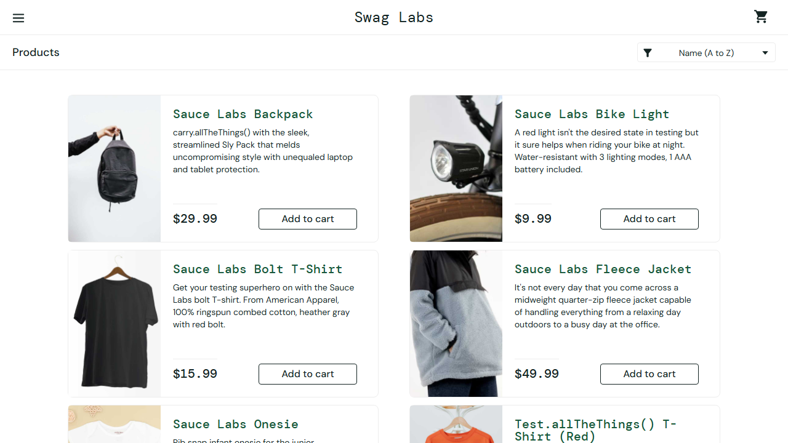

# BUG-007: Sorting does not reorder the product list

| | |
| --- | --- |
| **System** | SauceDemo |
| **Environment** | https://www.saucedemo.com/inventory.html, Chromium, Firefox, WebKit; Windows 11 |
| **Test user / data** | `problem_user` (silent), `error_user` (shows an alert) |
| **Severity** | Major (feature does not work; workaround is to scan the list by eye) |
| **Priority** | P2 |
| **Found by** | Exploratory session 2026-11-16, confirmed by TC-SD-013 |
| **Reproducibility** | Always |
| **Status** | Open |

## Steps to reproduce

1. Log in as `error_user` / `secret_sauce`.
2. In the sort dropdown choose **Name (Z to A)** (or any option other than the default).

## Expected result

The list is reordered (Test.allTheThings() T-Shirt first, Backpack last). No dialog.

## Actual result

An alert says `Sorting is broken! This error has been reported to Backtrace.` and the list stays in A to Z order. For `problem_user` there is no alert, but the list also does not change.

## Evidence

Alert text, captured by the evidence script (a native alert blocks screenshots): [BUG-007-error_user-sorting-alert.txt](evidence/BUG-007-error_user-sorting-alert.txt)

Automated: `tests/saucedemo/catalog.spec.ts` → TC-SD-013 (3 sort options × 2 users), expected failures. The test records any dialog and fails if one appears.
