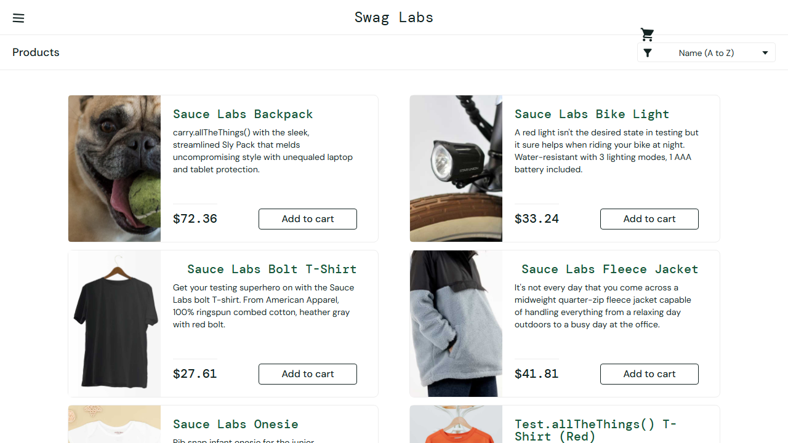

# BUG-008: Catalog shows wrong prices that change on every page load

| | |
| --- | --- |
| **System** | SauceDemo |
| **Environment** | https://www.saucedemo.com/inventory.html, Chromium, Firefox, WebKit; Windows 11 |
| **Test user / data** | `visual_user` |
| **Severity** | Critical (wrong prices shown to the customer; money) |
| **Priority** | P1 |
| **Found by** | Exploratory session 2026-11-16, confirmed by TC-SD-010 and TC-SD-013 |
| **Reproducibility** | Always (the wrong values differ on each load) |
| **Status** | Open |

## Steps to reproduce

1. Log in as `visual_user` / `secret_sauce`.
2. Compare the prices on **Products** with the catalog (Backpack $29.99, Bike Light $9.99, Bolt T-Shirt $15.99, Fleece Jacket $49.99, Onesie $7.99, Red T-Shirt $15.99).
3. Reload the page and compare again.

## Expected result

The same six prices as for `standard_user`, stable across reloads.

## Actual result

Random prices (for example Backpack **$69.83**, Fleece Jacket **$6.91**), different after each reload. Sorting by price orders the list by the real prices, so the list looks out of order (TC-SD-013).

## Evidence

Automated: `tests/saucedemo/catalog.spec.ts` → TC-SD-010 and TC-SD-013 (price options) for `visual_user`, expected failures.

## Notes

The cart and checkout overview still use the real prices, so what the customer sees and what they pay differ. That is the main risk here.
